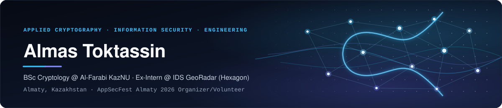

  

  
  
  
  

---

### About

Third-year **BSc Cryptology** student at **Al-Farabi Kazakh National University (KazNU)** specializing in **Applied Cryptography**, **Public Key Infrastructure (PKI)**, **Information Security**, and security-minded software engineering.

- **Industry Experience:** Former *Software & Radar Engineering Intern* at **IDS GeoRadar (Part of Hexagon) / Leica Geosystems** — built and deployed an internal LAN-hosted warehouse inventory platform with RBAC, alongside field networking (MikroTik RouterOS) and Leica DS2000 GPR hardware diagnostics.
- **Community:** Organizer & Volunteer at **AppSecFest Almaty 2026** (*AppSec · DevSecOps · Security Engineering*).
- **Currently Open To:** Internship & Junior roles in **Information Security**, **AppSec**, **Cryptography / PKI**, or **Security-Focused Software Engineering** (Almaty / Hybrid / Remote).

---

### Core Engineering & Security Stack

| Domain | Technologies & Concepts |
| :--- | :--- |
| **Applied Cryptography & PKI** | `RSA (OAEP / PSS / CRT)` · `ECDH (SECP521R1)` · `AES-256-GCM` · `HKDF` · `SHA-256` · `OpenSSL` · `PKI` |
| **Security & Infrastructure** | `Operating Systems Security` · `Network Security` · `Application Security` · `RBAC` · `TCP/IP` · `MikroTik RouterOS` · `Linux` |
| **Languages** | `Python` · `C++` · `C# (.NET / WPF)` · `TypeScript` · `JavaScript (ES6+)` |
| **Web & Tooling** | `Next.js` · `React` · `HTML5 / CSS3` · `Git` · `GitHub` · `LAN / Self-Hosted Deployment` |

---

### Selected Work

| Project | Stack | Highlights |
| :--- | :--- | :--- |
| **[RESTOCANVAS](https://github.com/lor0reader/RESTOCANVAS)** | `Next.js 16` · `React 19` · `TypeScript` | Interactive restaurant floorplan, table reservation, and staff role management system with local state persistence. |
| **Internal Warehouse & Inventory Platform** *(Private — IDS GeoRadar / Hexagon)* | `TypeScript` · `Next.js` · `Electron` · `RBAC` | Locally deployed intranet inventory system for industrial Leica DS2000 GPR units, spare parts, and stock movement tracking. |
| **Hybrid ECDH & RSA Authenticated Encryption Suite** *(Academic / Publishing Soon)* | `Python` · `PyCA Cryptography` · `OpenSSL` | ECDH (`P-521`) + `HKDF-SHA256` + `AES-256-GCM` with `RSA-2048` (`OAEP` + `PSS`) anti-MITM handshake layer and OpenSSL CLI verification. |
| **From-Scratch RSA Cryptosystem & Cryptanalysis Toolkit** *(Academic / Publishing Soon)* | `Python` · `Number Theory` | Pure-Python RSA primitives (40-round Miller-Rabin, EGCD, fast modular exponentiation, CRT optimization) and mathematical attack demos on weak parameters. |
| **UTK-1 — Hybrid ECC & AES-256 Desktop App** *(Academic / Publishing Soon)* | `C#` · `WPF` · `MVVM` · `TAP` | Asynchronous desktop encryption utility combining ECC key exchange, AES-256 bulk encryption, and SHA-256 integrity verification. |

---

### Certifications & Recognition

- **Public Key Infrastructure (PKI)** — *National Open University INTUIT* (36 academic hours · Nov 2026 · Reg. No. `C00134581`)
- **Operating System Foundations** — *Infosec via Coursera* (Feb 2026 · [Verify Credential `I1UTPFJN7I31`](https://coursera.org/verify/I1UTPFJN7I31))
- **Volunteer Appreciation Letter** — *AppSecFest Almaty 2026 Organizing Committee* (May 2026 · Farabi Hub, KazNU)
- **State Academic Scholarship** — *Al-Farabi KazNU* (4 consecutive semesters · Core coursework: Cryptology `A`, Software Development `A`, Information Protection `A-`, Crypto Algorithms & Data Structures `A-`)
